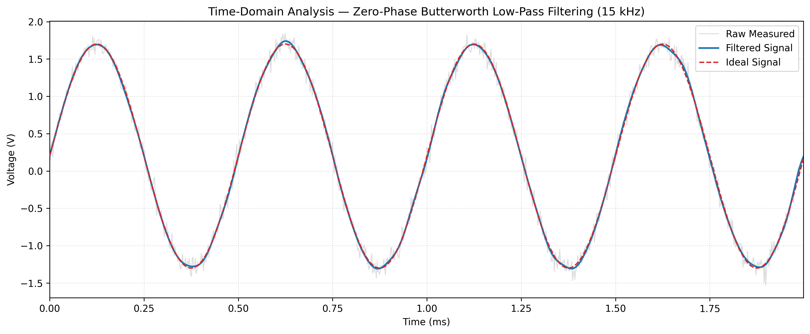
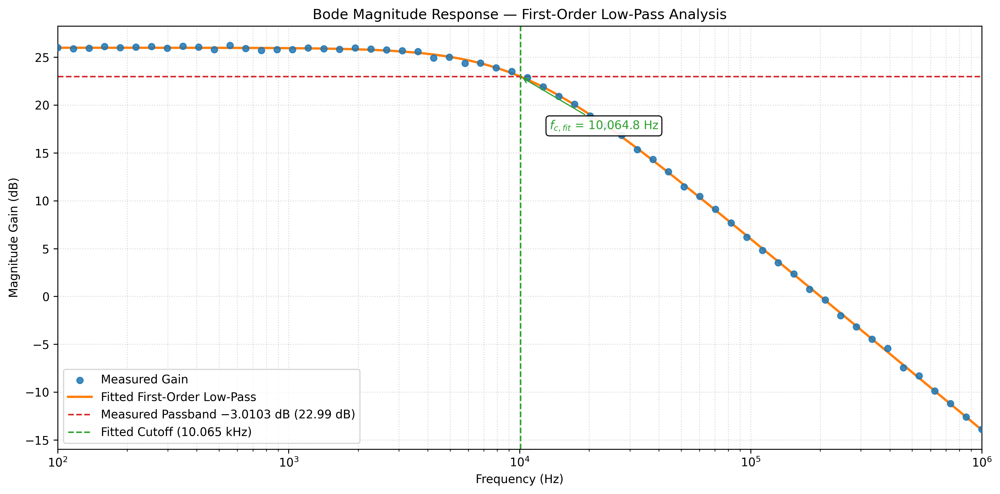

# Automated Oscilloscope Signal & Frequency Response Analyzer

A modular Python engineering toolkit for processing time-domain oscilloscope captures and automated AC frequency sweep measurements. Designed to replicate standard benchtop instrumentation workflows—denoising noisy sensor/circuit traces, extracting AC RMS parameters, and detecting $-3\text{ dB}$ cutoff frequencies via Bode magnitude modeling.

## Features

- **Synthetic Bench Data Generation:** Simulates realistic oscilloscope captures ($500\text{ kHz}$ sampling rate) and logarithmic AC frequency sweeps ($100\text{ Hz} - 1\text{ MHz}$) corrupted by Gaussian measurement noise.
- **Time-Domain Signal Processing:** Applies a 4th-order zero-phase Butterworth low-pass filter (`scipy.signal.filtfilt`) to eliminate high-frequency noise without phase distortion, extracting $V_{dc}$, $V_{pp}$, $V_{rms,\text{AC}}$, and residual SNR.
- **Frequency Response & Bode Analysis:** Computes gain in decibels ($20\log_{10}|H(f)|$), identifies the $-3.01\text{ dB}$ half-power cutoff frequency via log-frequency interpolation, and fits a theoretical 1st-order transfer function ($|H(f)| = A_0 / \sqrt{1 + (f/f_c)^2}$) using non-linear least squares (`scipy.optimize.curve_fit`).
- **Automated Reporting:** Generates high-resolution ($300\text{ dpi}$) diagnostic plots and exports a structured engineering test report (`test_report.txt`).

## Key Results

| Parameter | Nominal Reference | Raw Measured | Processed / Fitted | Relative Error |
| :--- | :---: | :---: | :---: | :---: |
| **Peak-to-Peak Voltage ($V_{pp}$)** | $3.000\text{ V}$ | $3.369\text{ V}$ | $3.048\text{ V}$ (Filtered) | $+1.61\%$ |
| **AC RMS Voltage ($V_{rms}$)** | $1.061\text{ V}$ | $1.065\text{ V}$ | $1.062\text{ V}$ (Filtered) | $+0.12\%$ |
| **Passband Gain ($A_0$)** | $26.02\text{ dB}$ ($20\text{ V/V}$) | $26.00\text{ dB}$ | $25.99\text{ dB}$ (Fitted) | $-0.32\%$ |
| **$-3\text{ dB}$ Cutoff Frequency ($f_c$)** | $10.00\text{ kHz}$ | $10.49\text{ kHz}$ (Interp.) | $10.06\text{ kHz}$ (Fitted) | $+0.65\%$ |

## Diagnostic Plots

### 1. Time-Domain Denoising

### 2. Bode Magnitude Response & $-3\text{ dB}$ Detection

## Tech Stack
- **Python 3** (`NumPy`, `SciPy`, `Pandas`, `Matplotlib`)
